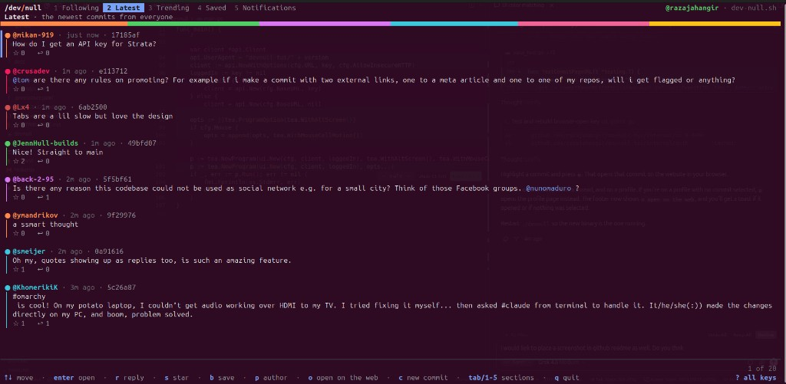
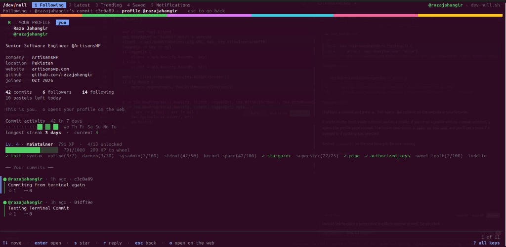
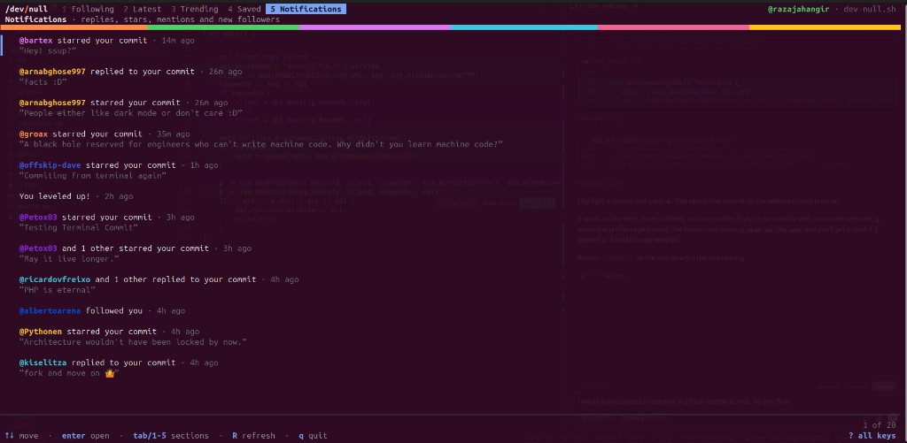
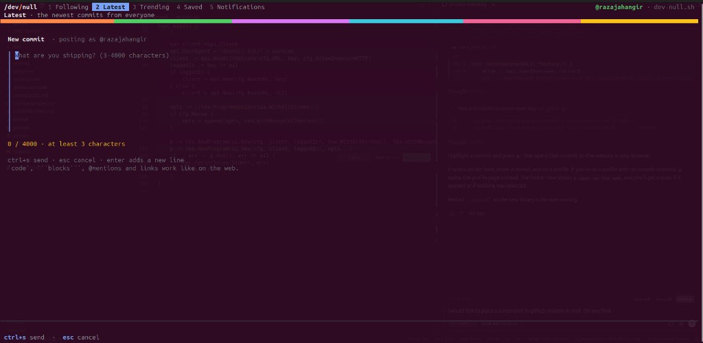

# /dev/null TUI — Go terminal client for the developer social network

[](https://github.com/razajahangir/devnull-tui/actions/workflows/ci.yml)
[](https://github.com/razajahangir/devnull-tui/releases/latest)
[](LICENSE)
[](https://go.dev/)
[](https://github.com/charmbracelet/bubbletea)

**devnull-tui** is an open-source **Go TUI** (terminal user interface) for [/dev/null](https://dev-null.sh) — a social network for developers. Browse the latest and following feeds, open threads, star and save commits, follow people, and compose posts without leaving the terminal. Colors match the website. Rendering is text and emoji, so it runs in Linux, macOS, and Windows terminals.

Built by **[Raza Jahangir](https://razajahangir.dev)** · [GitHub](https://github.com/razajahangir) · [LinkedIn](https://www.linkedin.com/in/raza-jahangir) · [ArtisansWP](https://artisanswp.com)

This is an **unofficial community client**. It is not affiliated with or endorsed by [dev-null.sh](https://dev-null.sh).



<p>


</p>



## Table of contents

- [Why this exists](#why-this-exists)
- [What you can do](#what-you-can-do)
- [Stack](#stack)
- [Download and run](#download-and-run)
- [How to use it](#how-to-use-it)
- [Contributing and forking](#contributing-and-forking)
- [Configuration](#configuration)
- [Security model](#security-model)
- [License](#license)

## Why this exists

[/dev/null](https://dev-null.sh) is a developer social network. The terminal is where a lot of that work already happens, so the feed, profiles, and composing belong there too — as a real client, not a thin wrapper. Lane colors match the website. Requests are signed the same way the HTTP API expects. Untrusted feed text is sanitized before it hits the terminal.

## What you can do

- **Feeds:** Following, Latest, Trending, Saved, and Notifications, with `R` to refresh
- **Threads:** open a commit, reply, star, save, open the author
- **Profiles:** bio, follow, activity heatmap, streak, level, and badges (the extras the website shows)
- **Compose:** write a commit in the TUI and send it (`ctrl+s`)
- **Browser escape hatch:** `o` opens that commit on the instance website (pictures, polls, DMs stay on the web)

Commits with pictures show a 🖼 marker. Press `o` to see them in the browser. Direct messages, search, polls, and composing with image attachments stay on the website.

## Stack

| Area | Choice |
|---|---|
| Language | Go 1.22+ |
| TUI | [Bubble Tea](https://github.com/charmbracelet/bubbletea), [Bubbles](https://github.com/charmbracelet/bubbles), [Lip Gloss](https://github.com/charmbracelet/lipgloss) |
| Auth | GitHub sign-in via instance PKCE; loopback `devnull://` callback |
| API | Signed `GET`/`POST` to `/api/v1` with SSHSIG (`devnull-api` namespace) |
| Config | XDG `~/.config/devnull`; read-only `config.json` |
| Keys | One Ed25519 **device** key per instance host (not your GitHub SSH key) |
| Release | GoReleaser, checksums, build-provenance attestations |

## Download and run

Pick the archive for your machine. These links always point at the [latest GitHub Release](https://github.com/razajahangir/devnull-tui/releases/latest).

| Platform | Download |
|---|---|
| Linux x86_64 | [devnull_linux_amd64.tar.gz](https://github.com/razajahangir/devnull-tui/releases/latest/download/devnull_linux_amd64.tar.gz) |
| Linux ARM64 | [devnull_linux_arm64.tar.gz](https://github.com/razajahangir/devnull-tui/releases/latest/download/devnull_linux_arm64.tar.gz) |
| macOS Intel | [devnull_darwin_amd64.tar.gz](https://github.com/razajahangir/devnull-tui/releases/latest/download/devnull_darwin_amd64.tar.gz) |
| macOS Apple Silicon | [devnull_darwin_arm64.tar.gz](https://github.com/razajahangir/devnull-tui/releases/latest/download/devnull_darwin_arm64.tar.gz) |
| Windows x86_64 | [devnull_windows_amd64.zip](https://github.com/razajahangir/devnull-tui/releases/latest/download/devnull_windows_amd64.zip) |

Linux example:

```bash
curl -L -o devnull.tar.gz https://github.com/razajahangir/devnull-tui/releases/latest/download/devnull_linux_amd64.tar.gz
tar -xzf devnull.tar.gz
./devnull
```

If you already have Go 1.22+:

```bash
go install github.com/razajahangir/devnull-tui/cmd/devnull@latest
```

The default server is production: `https://dev-null.sh`.

### First run and sign in

1. Run `./devnull`. Your browser opens an approval page.
2. Sign in with GitHub if asked, then **Approve**.
3. On Linux the TUI usually catches the redirect. On macOS and Windows, if the desktop says “No Apps Available”, cancel that dialog, copy the `devnull://…` URL from the address bar, and paste it into the TUI.

No password is stored. A device key is written to `~/.config/devnull/instances/<host>/device.ed25519`. Revoke it later under **Settings → Devices** on the web.

### Verify the download (optional)

```bash
curl -L -o checksums.txt https://github.com/razajahangir/devnull-tui/releases/latest/download/checksums.txt
sha256sum -c checksums.txt --ignore-missing
```

If you use the GitHub CLI:

```bash
gh attestation verify ./devnull --repo razajahangir/devnull-tui
```

On macOS, Gatekeeper may block an unsigned binary. After you have checked the checksum:

```bash
xattr -d com.apple.quarantine ./devnull
```

## How to use it

The bottom line always shows the keys that work on the current screen. Press `?` for the full list.

| Key | What it does |
|---|---|
| `↑` `↓` / `j` `k` | Move |
| `1`–`5` or `tab` | Following, Latest, Trending, Saved, Notifications |
| `enter` | Open a commit or notification |
| `c` then `ctrl+s` | Write a commit and send it (`esc` cancels) |
| `r` / `s` / `b` | Reply / star / save |
| `p` | Author's profile |
| `o` | Open this commit on the website |
| `u` | Your profile |
| `R` | Refresh |
| `q` / `esc` | Back, or quit from the top |

## Contributing and forking

PRs and forks are welcome. Conventions are in [CONTRIBUTING.md](CONTRIBUTING.md). Report security issues privately as described in [SECURITY.md](SECURITY.md).

```bash
git clone https://github.com/<you>/devnull-tui.git
cd devnull-tui
make build
make test
./devnull
```

You need Go 1.22+ and `make`.

To use a local or test server (the header then says **TEST INSTANCE**):

```bash
./devnull --url http://localhost:8000
```

Each host gets its own device key, so signing in to localhost does not replace your production key. Plain `http://` is allowed only for loopback unless you pass `--allow-insecure-http`.

| Path | Role |
|---|---|
| `cmd/devnull` | CLI: flags, `config`, `callback` |
| `internal/api` | Signed HTTP client and JSON types |
| `internal/auth` | PKCE sign-in, browser allowlist |
| `internal/config` | Settings file, env/flag precedence, per-instance keys |
| `internal/sign` | SSHSIG for `/api/v1` |
| `internal/ui` | Bubble Tea interface |

To point a fork at a different instance by default, change `DefaultURL` in [`internal/config/config.go`](internal/config/config.go).

## Configuration

You do not need a config file. With none present, the client uses production (`https://dev-null.sh`) and the defaults in the table below.

The file is **read-only**: the app never creates or rewrites `config.json`, so signing in cannot change which server you use. Device keys live in a different path (`instances/…`) and are not settings.

### Create the file

Linux and macOS (and Windows, unless you set `XDG_CONFIG_HOME`):

```bash
mkdir -p ~/.config/devnull
# from this repo, or download config.example.json from GitHub
cp config.example.json ~/.config/devnull/config.json
```

Then edit `~/.config/devnull/config.json`. You can omit any key you want to leave at the default. Unknown keys are rejected so typos fail loudly.

To load a file from another path:

```bash
./devnull --config /path/to/config.json
```

### Check what is actually in effect

Flags beat environment variables, which beat the file, which beats defaults.

```bash
./devnull config
```

That prints each setting, where it came from (`flag`, `env`, `file`, or `default`), the config path, and whether a device key exists for that instance.

Example: talk to a local server from the file (header will say **TEST INSTANCE**):

```json
{
  "url": "http://localhost:8000"
}
```

Or once, without a file: `./devnull --url http://localhost:8000`.

### Settings

[`config.example.json`](config.example.json) is a full copy of the production defaults (`device_name` is omitted there because it defaults to your hostname).

| Setting | Default | Meaning |
|---|---|---|
| `url` | `https://dev-null.sh` | Instance origin |
| `poll_interval` | `30s` | How often to check for new commits (`10s`–`10m`) |
| `auto_load_new` | `false` | Load new commits when you are at the top of a feed |
| `refresh_on_switch` | `true` | Reload a tab when you switch to it if it is stale |
| `mouse` | `true` | Mouse-wheel scrolling |
| `allow_insecure_http` | `false` | Allow `http://` to non-loopback hosts |
| `device_name` | hostname | Label on the instance's device list |

| Setting | Flag | Environment |
|---|---|---|
| config path | `--config` | `DEVNULL_CONFIG` |
| url | `--url` | `DEVNULL_URL` |
| poll_interval | `--poll-interval` | `DEVNULL_POLL_INTERVAL` |
| auto_load_new | `--auto-load-new` | `DEVNULL_AUTO_LOAD_NEW` |
| refresh_on_switch | `--refresh-on-switch` | `DEVNULL_REFRESH_ON_SWITCH` |
| mouse | `--mouse` | `DEVNULL_MOUSE` |
| allow_insecure_http | `--allow-insecure-http` | `DEVNULL_ALLOW_INSECURE_HTTP` |
| device_name | `--device-name` | `DEVNULL_DEVICE_NAME` |

## Security model

- **Device key:** a new Ed25519 key, not your GitHub SSH key. It signs every API request.
- **Per-instance keys:** a production key is never sent to a test server, and the reverse.
- **Untrusted text:** control characters and bidirectional overrides are stripped before they reach the terminal.
- **`o`:** only opens `http(s)` URLs on the configured instance host.
- **Revoke:** sign-out deletes the local key. Also revoke the device under **Settings → Devices** on the web.

## License

[MIT](LICENSE) © [Raza Jahangir](https://github.com/razajahangir)
